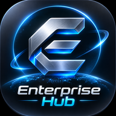

<h1 align="center">Enterprise Hub Lite</h1>

<b>Диагностика Android-устройства без 3D-разбора</b> Железо, экран, память, камеры, датчики, связь, тесты и безопасная очистка.

  
  
  
  

---

**Это лёгкая версия без 3D-конструктора.** Осталось всё, что работает с реальными данными устройства и не нагружает графику.

## Возможности

- **Паспорт устройства** — процессор с маркетинговым именем, ядра и частоты, память, накопитель, экран, батарея с износом, камеры, датчики, кодеки, DRM. С пояснением к каждому параметру.
- **Монитор** — загрузка ЦП, память, сеть, батарея, температуры в реальном времени.
- **Хранилище и приложения** — занятое место, крупные файлы, статистика экранного времени.
- **Сравнение** — с каталогом на 10 000+ моделей: экран, чип, камеры, питание, поддержка.
- **Проверка** — восемь тестов компонентов с вердиктом «пройдено / есть проблема» и стресс-проверка с графиком температуры.
- **Связь** — Wi-Fi, сотовая сеть, Bluetooth, USB, NFC, датчики.
- **Безопасная очистка** — файлы не удаляются, а переносятся в корзину; фото, видео и документы защищены стоп-листом.
- **Аудит приватности**, отчёт в Markdown, виджеты, плавающий монитор.

## Установка

1. Откройте раздел **[Releases](../../releases)** и скачайте APK.
2. Разрешите установку из этого источника.
3. Запустите — регистрация и интернет не нужны.

Обновления ставятся поверх: подпись не меняется, данные сохраняются.

## Требования

Android 8.0 и новее, arm64-v8a или armeabi-v7a.

## Лицензия

Проприетарная. Личное использование разрешено; распространение, продажа и коммерческое использование — только с письменного разрешения автора. Текст — в [LICENSE](LICENSE).

## Автор

Приложение и оформление — **Дмитрий Стариков** ([@EnterPC-Core](https://github.com/EnterPC-Core)).

- Другие приложения: [Enterprise Core](https://github.com/EnterPC-Core/EnterpriseCore-Releases) · [Enterprise Shield](https://github.com/EnterPC-Core/EnterpriseShield-Android)
