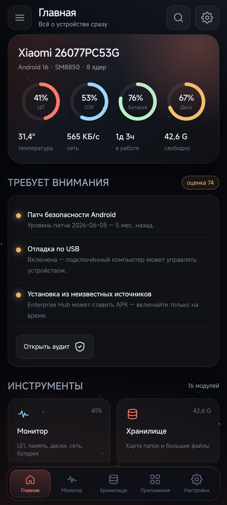
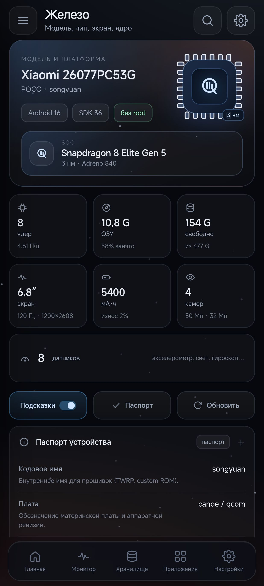
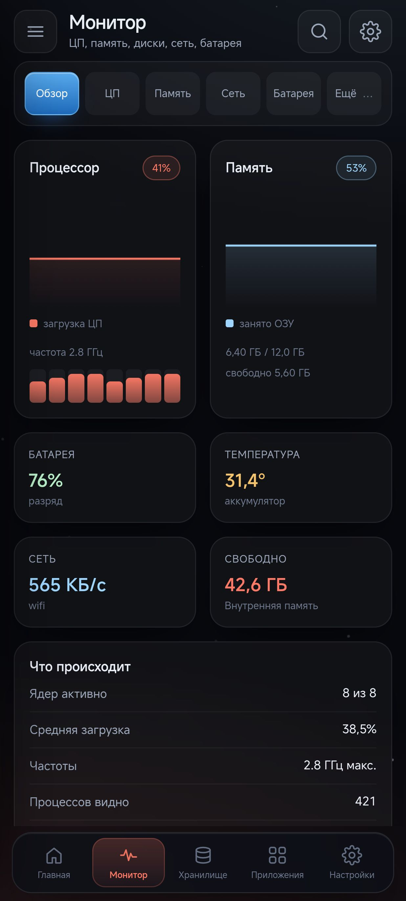
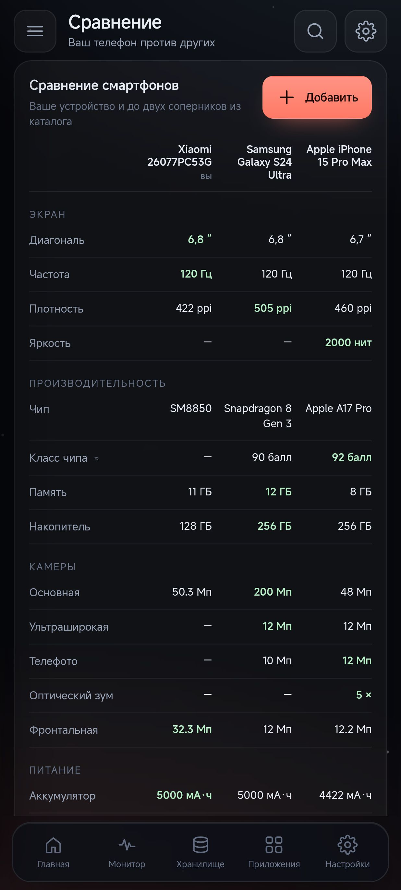
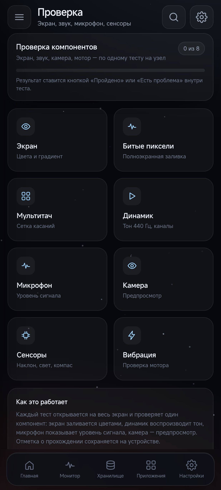
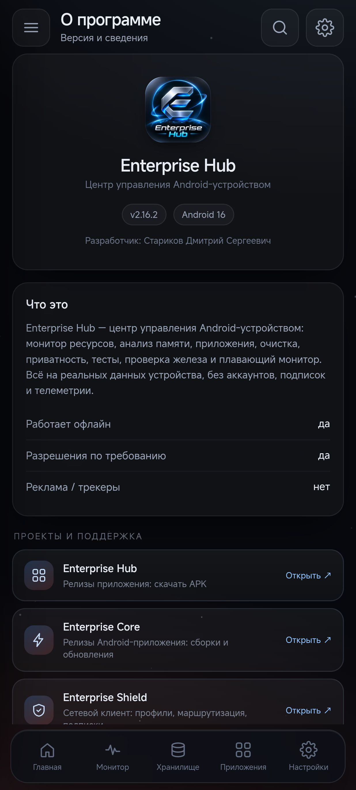
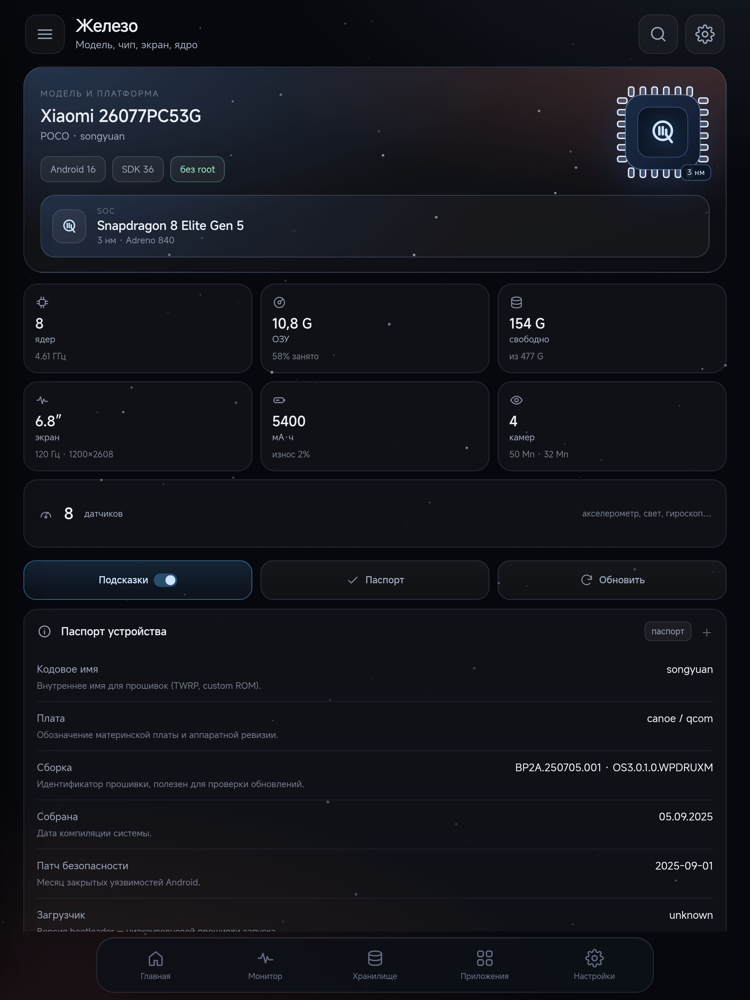
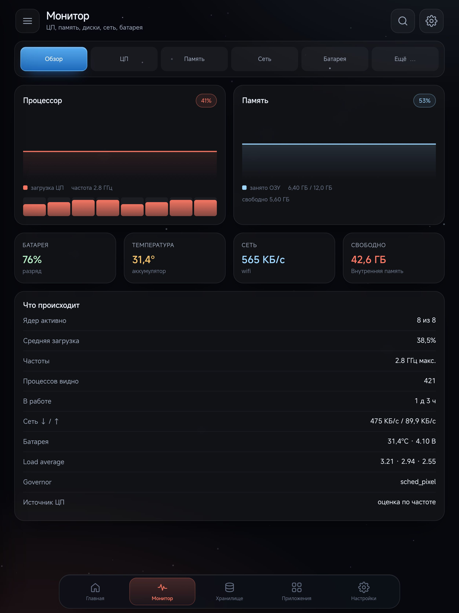

  

<h1 align="center">Enterprise Hub</h1>

  <b>Полный паспорт вашего Android-устройства</b> 
  Железо, экран, память, камеры, датчики, связь и проверка компонентов — в одном приложении.

  
  
  
  

---

**Enterprise Hub** показывает то, что обычно спрятано в системе: реальные частоты каждого ядра, маркетинговое имя чипа вместо служебного кода, температуры термозон, ёмкость и износ аккумулятора, характеристики всех камер, список датчиков, кодеки, уровень DRM и ещё десятки параметров. Без root. Без рекламы. Без сбора данных.

Приложение полезно, когда нужно понять, почему телефон греется, сколько на самом деле осталось ёмкости батареи, какие частоты держит процессор под нагрузкой, чем отличается ваш аппарат от нового, и проверить, всё ли работает в железе перед покупкой с рук.

## Возможности

### Паспорт устройства
- Маркетинговое название процессора (Snapdragon 8 Elite Gen 5, Dimensity 9300, Tensor G4 и т. д.) — база на 120+ чипов, включая платформенные алиасы.
- Техпроцесс, графическое ядро, год выхода, класс чипа.
- Каждое ядро отдельно: текущая частота, максимум, governor, кластеры big.LITTLE.
- Пояснение к каждому параметру — что это и на что влияет.

### Экран и корпус
- Разрешение, плотность, диагональ, соотношение сторон.
- Все поддерживаемые частоты обновления и режимы экрана.
- HDR-форматы (HDR10, HDR10+, Dolby Vision, HLG), широкий цветовой охват.
- Размеры в dp, класс устройства — телефон, планшет, складной.

### Память и накопитель
- Оперативная память: занято, свободно, кэш, подкачка/ZRAM, порог нехватки.
- Накопитель: раздел `/data`, системные разделы, съёмные тома.
- Тип шины (UFS/eMMC), состояние шифрования.

### Батарея
- Уровень, статус, здоровье, температура, напряжение, ток заряда.
- Проектная и фактическая ёмкость, износ в процентах, число циклов.
- Производитель и модель аккумулятора — если прошивка их отдаёт.

### Камеры
- Все модули, которые видит система: разрешение, мегапиксели, видео (включая 4K).
- Диафрагма, фокусное расстояние, размер сенсора, оптическая стабилизация.
- RAW, карта глубины, логические мультикамеры, уровень Camera2 API.

### Датчики и связь
- Полный список датчиков: тип, производитель, потребление, диапазон, разрешение, частота, пробуждающие сенсоры.
- Wi-Fi: сеть, сигнал, скорость канала, диапазон, IP.
- Сотовая сеть, SIM, Bluetooth, NFC, GPS, USB-хост, UWB, ИК, eSIM.

### Монитор в реальном времени
- Загрузка процессора по ядрам, частота, температура.
- Память, диски, сеть, батарея — с графиком за последние секунды.
- Плавающий компактный монитор поверх других приложений.

### Сравнение
- Ваш аппарат против двух моделей из каталога на 10 000+ устройств.
- Экран, производительность, камеры, питание, корпус, поддержка — с подсветкой лучшего значения.

### Проверка и стресс-тест
- Восемь тестов компонентов с честной отметкой «Пройдено» или «Есть проблема».
- Стресс-проверка на 1, 10, 20 или 30 минут с графиком нагрузки и температуры.
- Отчёт о состоянии устройства в Markdown — можно сохранить и отправить.

### Аудит и приватность
- Оценка безопасности: патч-уровень, root, отладка по USB, неизвестные источники, шифрование.
- Все данные читаются на устройстве. Приложение не отправляет их в сеть и не содержит аналитики.

## Скриншоты

<table align="center">
  <tr>
    <td align="center"> <b>Главная</b> — состояние устройства</td>
    <td align="center"> <b>Железо</b> — паспорт и чип</td>
    <td align="center"> <b>Монитор</b> — ЦП, память, сеть</td>
  </tr>
  <tr>
    <td align="center"> <b>Сравнение</b> — с каталогом моделей</td>
    <td align="center"> <b>Проверка</b> — восемь тестов</td>
    <td align="center"> <b>О программе</b> — проекты и поддержка</td>
  </tr>
</table>

### Планшетный режим

На экранах от 600 dp интерфейс раскрывается на всю ширину: плитки и таблицы становятся просторнее, текст не растягивается на строку в метр, навигация остаётся под рукой.

  
  

## Установка

1. Откройте раздел **[Releases](../../releases)** и скачайте последний APK.
2. Разрешите установку из этого источника, когда система спросит.
3. Установите и запустите — регистрация и интернет не нужны.

Обновления ставятся поверх предыдущей версии: подпись приложения не меняется, данные и настройки сохраняются.

## Разрешения и зачем они нужны

| Разрешение | Зачем |
|---|---|
| Телефон / состояние сети | Определить оператора, тип сети, SIM — только отображение |
| Камера | Список модулей и их характеристики; съёмка не ведётся без вашего действия |
| Микрофон | Только тест микрофона по нажатию |
| Bluetooth | Список сопряжённых устройств и версия адаптера |
| Местоположение | Wi-Fi и Bluetooth на Android 10+ требуют его для чтения имени сети |
| Использование приложений | Статистика экранного времени и размер приложений |
| Поверх других приложений | Плавающий монитор — по желанию, отключается |

Любое разрешение можно отклонить: приложение продолжит работать, просто часть строк будет недоступна.

## Требования

- Android 8.0 и новее (API 26–36).
- Процессор arm64-v8a или armeabi-v7a.
- Около 120 МБ свободного места.

## Лицензия

Приложение распространяется по **проприетарной лицензии**. Кратко:

- личное некоммерческое использование на собственных устройствах — разрешено;
- распространение APK, публикация на сторонних сайтах, продажа, перепродажа и включение в другие продукты — запрещены;
- декомпиляция, модификация и обход защиты — запрещены;
- коммерческое использование и распространение — только с моего письменного разрешения.

Полный текст — в файле [LICENSE](LICENSE).

## Кто это сделал

Приложение, интерфейс и оформление — **Дмитрий Стариков** ([@EnterPC-Core](https://github.com/EnterPC-Core)).
Код, дизайн, тексты и скриншоты — мои.

- Мои другие проекты: [Enterprise Core](https://github.com/EnterPC-Core/EnterpriseCore-Releases) · [Enterprise Shield](https://github.com/EnterPC-Core/EnterpriseShield-Android)

Enterprise Hub — инструмент диагностики. Показания берутся из системных API и sysfs; часть данных производитель может скрывать, тогда строка помечается как недоступная.
